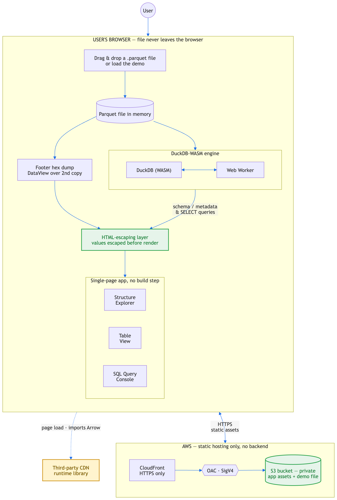
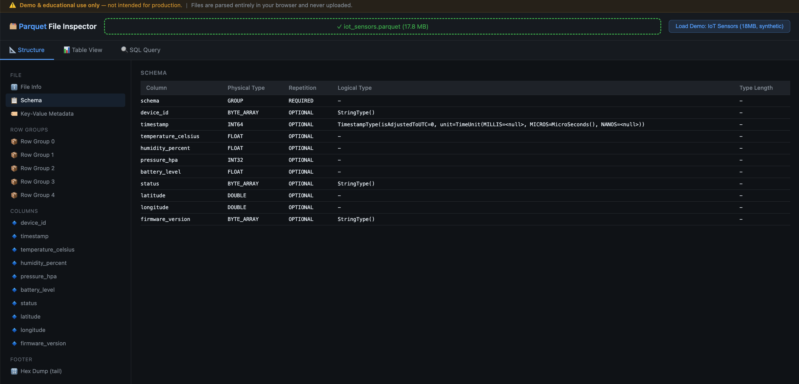
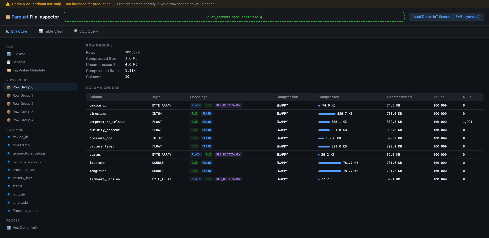
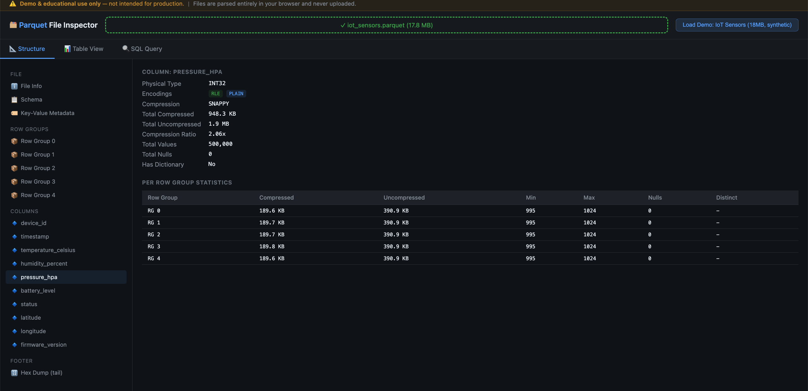
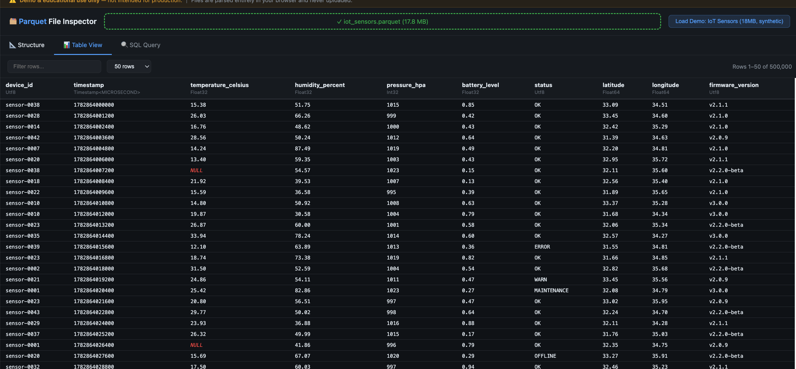
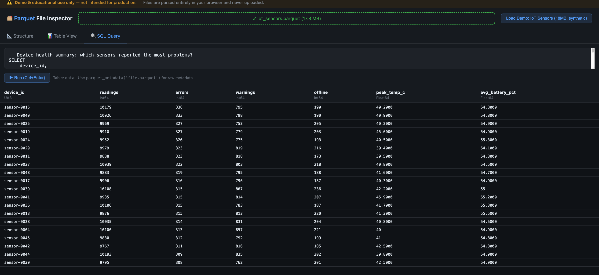

# Parquet File Inspector

> **⚠️ Disclaimer:** This is a sample project for educational and demonstration purposes.
> It is NOT intended for production use without further hardening (CSP headers, accessibility
> audit, input validation, monitoring). Use at your own risk.
>
> The preloaded demo file exists to demonstrate **the tool**, not the data. It is randomly
> generated by `scripts/generate_sample_data.py` — the device IDs, readings, and statuses
> are synthetic and describe no real equipment. Do not cite it as a source.

> **💰 Estimated AWS Cost:** ~$1-2/month when idle (S3 storage + CloudFront minimum charges).
> With active usage (e.g., 100 users/day downloading the demo file): ~$3-5/month.
> Tear down with `cdk destroy` when no longer needed.

A browser-based Apache Parquet file inspector that lets you explore the internal structure of Parquet files - schema, row groups, column chunks, encodings, compression, statistics, and raw footer bytes - entirely client-side.



## Features

- **Structure Explorer** - Navigate file metadata, schema tree, row groups, and individual column chunks with encoding/compression details
- **Table View** - Paginated, human-readable data table with column type badges and NULL highlighting
- **SQL Query Console** - Ad-hoc SQL queries powered by DuckDB-WASM (full analytical SQL on your Parquet file)
- **Footer Hex Dump** - Raw binary inspection of the Thrift-encoded Parquet footer
- **Key-Value Metadata** - View pandas schema, Arrow metadata, and custom application metadata (prettified JSON)
- **Zero Backend** - Everything runs in your browser via WebAssembly. No data is uploaded anywhere.
- **Any Parquet File** - Drag-and-drop any `.parquet` file. Includes a synthetic IoT sensor demo dataset (500K rows, 5 row groups).

## Screenshots

All views below are inspecting the bundled synthetic IoT sensor demo file
(500K rows, 5 row groups).

### Structure tab - schema

The full Parquet schema - physical type, repetition, and logical type annotations
for every column, including the nested `TimestampType` unit metadata.



### Structure tab - row group and column chunks

Per-row-group totals (rows, compressed and uncompressed size, compression ratio)
alongside every column chunk in that group, with encodings shown as badges.

This view makes encoding choices concrete. The low-cardinality `device_id`,
`status`, and `firmware_version` columns pick up `RLE_DICTIONARY` and end up
far smaller in absolute terms (26-74 KB) than the `latitude`/`longitude`
doubles (782 KB each) - the dictionary collapses the repetition before the
compressor ever runs. Those doubles are the opposite case: uniformly random
float64 is incompressible, and SNAPPY leaves them marginally *larger* than
their uncompressed size.



### Structure tab - column statistics

A single column rolled up across all row groups, with the per-row-group min/max
statistics that engines use to skip row groups during predicate pushdown.

`pressure_hpa` is the best-compressing column in the file at 2.06x - an `INT32`
confined to a narrow 995-1024 range, which is exactly the shape that RLE
handles well.



### Table view

The decoded rows, paginated 50 at a time out of 500,000, with a filter box and
an adjustable page size. Each column header carries its Arrow type (`Utf8`,
`Timestamp<MICROSECOND>`, `Float32`, `Int32`, `Float64`), and NULLs are called
out in red rather than rendered as blanks - the nulls visible in
`temperature_celsius` here are the same 1,991 that the row group view reports
for that column.



### SQL query console

Full analytical SQL against the loaded file, executed by DuckDB-WASM in the
browser - no server involved. The file is registered as the table `data`, and
`parquet_metadata('file.parquet')` is available for querying the raw metadata
directly.

Shown here is the query the tab is preloaded with: a per-device health summary
using `FILTER` aggregates to break reading counts down by status.



## Architecture

```
User's Browser
├── index.html (UI - vanilla HTML/CSS/JS)
├── DuckDB-WASM (parquet parsing + SQL engine)
│   ├── parquet_metadata() - row groups, column chunks, encodings
│   ├── parquet_schema() - column types, logical types
│   ├── parquet_file_metadata() - file-level info
│   └── parquet_kv_metadata() - key-value pairs
└── Raw ArrayBuffer (footer hex dump)

Hosting (AWS)
├── S3 Bucket (private, OAC)
├── CloudFront Distribution (HTTPS, caching)
└── CloudFront Function (SPA routing)
```

**No server-side processing.** Parquet files are parsed entirely in the browser using DuckDB compiled to WebAssembly. The hosting infrastructure only serves static files.

## Prerequisites

- [Node.js](https://nodejs.org/) >= 18
- [AWS CDK](https://docs.aws.amazon.com/cdk/v2/guide/getting-started.html) >= 2.150
- AWS account with permissions to create S3, CloudFront, Lambda, and IAM resources
- AWS CLI configured with credentials
- Python 3 with `pyarrow` and `numpy` (only needed to generate sample data)

## Quick Start

### Deploy Locally

**If you are deploying to AWS, skip this section.** `scripts/deploy.sh` fetches the
WASM binaries and generates the demo dataset for you if either is missing.

You only need these steps to **serve the app locally**:

```bash
# 1. Download the DuckDB-WASM binaries (~73MB, into src/frontend/duckdb/)
./scripts/download-duckdb-wasm.sh

# 2. Generate the demo dataset (writes to sample-data/iot_sensors.parquet)
pip3 install pyarrow numpy
python3 scripts/generate_sample_data.py

# 3. For LOCAL serving only, copy the demo file next to index.html
#    (local serving serves everything from src/frontend/)
cp sample-data/iot_sensors.parquet src/frontend/

# 4. Serve
cd src/frontend
python3 -m http.server 8080
# open http://localhost:8080
```

Without step 1 the page fails with "DuckDB failed to load". Without step 2 the
**Load Demo: IoT Sensors** button returns a 404 (drag-and-drop of your own files
still works).

### Deploy to AWS

```bash
# Install dependencies
# One time per account+region:
npx cdk bootstrap aws://ACCOUNT_ID/REGION
export CDK_DEFAULT_REGION=us-east-1   # change to your region, if not set or running from CloudShell
# (find account: aws sts get-caller-identity --query Account --output text)
pip3 install pyarrow numpy
# Then:
./scripts/deploy.sh
# Output: CloudFront URL
```

The CDK deployment uploads everything in `src/frontend/` to S3, so the WASM
binaries and the demo Parquet file must be in place (see first-time setup)
before deploying — otherwise the deployed site will be missing them.

### Sample Data

The built-in demo dataset is generated. `scripts/deploy.sh` creates it
automatically if absent, so you only need this when serving locally.

```bash
pip3 install pyarrow numpy

# Synthetic IoT sensor readings - 500K rows, 4-5 row groups, ~18MB.
# Writes to sample-data/. This is the file the "Load Demo" button loads,
# so copy it to src/frontend/ when serving locally.
python3 scripts/generate_sample_data.py
```

The generator is seeded, so the output is reproducible across runs.

## Project Structure

```
parquet-file-inspector/
├── README.md                    # This file
├── LICENSE                      # MIT License
├── .gitignore                   # Git ignore rules
├── docs/
│   ├── architecture.md          # Detailed architecture documentation
│   └── parquet-format.md        # Parquet format reference
├── src/
│   └── frontend/
│       ├── index.html           # Main application (single-file SPA)
│       └── duckdb/              # Self-hosted DuckDB-WASM assets
│           ├── duckdb-browser.mjs
│           ├── duckdb-eh.wasm
│           ├── duckdb-mvp.wasm
│           ├── duckdb-browser-eh.worker.js
│           └── duckdb-browser-mvp.worker.js
├── infrastructure/
│   ├── package.json             # CDK dependencies
│   ├── cdk.json                 # CDK configuration
│   └── cdk-app.js              # CDK stack definition
├── scripts/
│   ├── generate_sample_data.py  # Generate demo Parquet file
│   └── deploy.sh               # One-command deploy script
└── sample-data/
    └── .gitkeep                 # Generated files go here (not committed)
```

## How It Works

### DuckDB-WASM Integration

The inspector uses [DuckDB-WASM](https://duckdb.org/docs/api/wasm/overview) to parse Parquet files. DuckDB provides several introspection functions:

| Function | Returns |
|----------|---------|
| `parquet_schema('file.parquet')` | Column names, physical types, logical types, repetition |
| `parquet_metadata('file.parquet')` | Per-column-chunk: encodings, compression, sizes, statistics |
| `parquet_file_metadata('file.parquet')` | File-level: row count, row groups, format version, creator |
| `parquet_kv_metadata('file.parquet')` | Key-value metadata pairs (pandas schema, Arrow schema) |

### Self-Hosted WASM

DuckDB-WASM assets (~35MB WASM + worker JS) are self-hosted on the same CloudFront distribution to avoid:
- Cross-origin Worker restrictions (browsers block `new Worker()` from different origins)
- MIME type issues (`.wasm` files require `Content-Type: application/wasm`)
- CDN reliability dependency

### Security

- S3 bucket is **fully private** (BlockPublicAccess.BLOCK_ALL)
- Access only via CloudFront using Origin Access Control (OAC)
- No server-side code, no Lambda, no API Gateway
- No data leaves the user's browser
- HTTPS enforced via CloudFront viewer protocol policy

## Configuration

### Custom Domain

To use a custom domain, add these to the CDK stack:

```javascript
// In infrastructure/cdk-app.js
const certificate = acm.Certificate.fromCertificateArn(this, 'Cert', 'arn:aws:acm:us-east-1:...');
// Add to distribution:
domainNames: ['parquet.yourdomain.com'],
certificate,
```

### Demo File

The "Load Demo" button fetches `iot_sensors.parquet` from the root of the
S3 bucket, as a same-origin relative path. To use your own demo file instead,
either name it `iot_sensors.parquet` or update the `fetch()` call in
`src/frontend/index.html`.

The file is generated by `scripts/generate_sample_data.py` and is gitignored - see
[First-time setup](#first-time-setup). Its contents are synthetic (see the
disclaimer at the top of this file); it is there to exercise the inspector, not to
serve as a dataset.

The default query in the SQL tab is written against this schema, so it will need
changing if you swap in a different demo file.

## Cleanup

```bash
cd infrastructure
cdk destroy
```

This removes all AWS resources (S3 bucket, CloudFront distribution, Lambda functions).

## Contributing

1. Fork the repository
2. Create a feature branch (`git checkout -b feature/my-feature`)
3. Commit your changes (`git commit -am 'Add my feature'`)
4. Push to the branch (`git push origin feature/my-feature`)
5. Create a Merge Request

## License

This project is licensed under the MIT-0 License - see the [LICENSE](LICENSE) file for details.
No attribution required.

## Acknowledgments

- [DuckDB](https://duckdb.org/) - Analytical SQL engine compiled to WebAssembly
- [Apache Parquet](https://parquet.apache.org/) - Columnar storage format
- [Apache Arrow](https://arrow.apache.org/) - In-memory columnar data format
